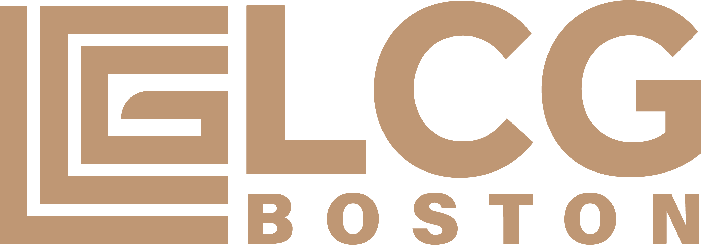
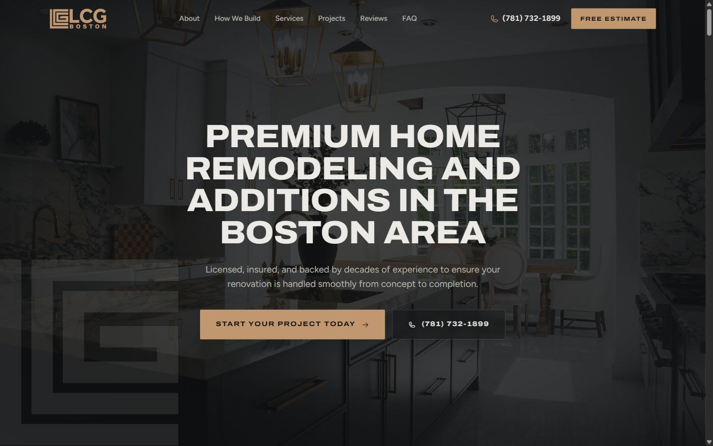
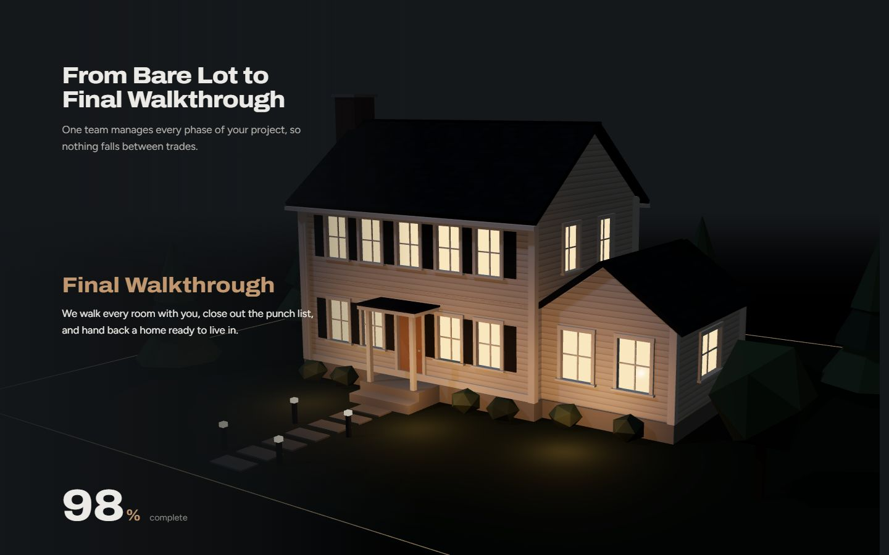
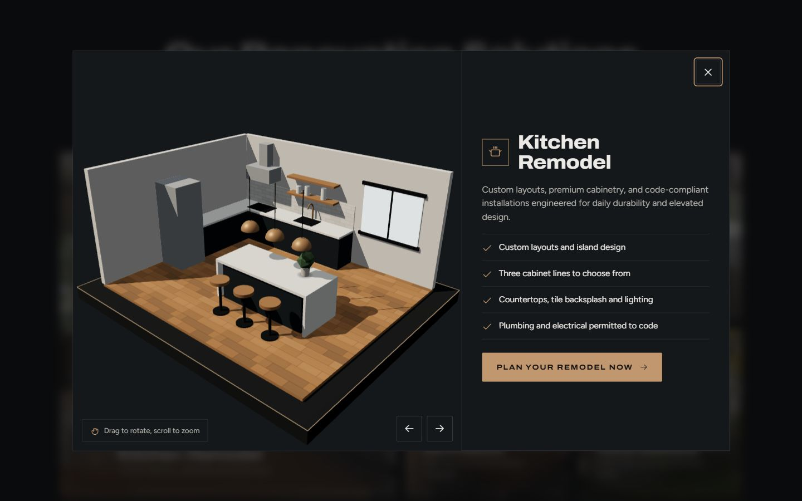

<div align="center">



<h3>Site institucional one page · LCG Boston LLC</h3>

<p>Premium Home Remodeling and Additions in the Boston Area</p>

<p>
  
  
  
  
  
  
</p>

<p>
  <a href="https://lcg.escolats.com.br"><b>Ambiente de teste</b></a>
  ·
  <a href="#rodar-localmente">Rodar localmente</a>
  ·
  <a href="#deploy">Deploy</a>
</p>

</div>

<br>



## Sobre

One page de alta conversão para a **LCG Boston LLC**, general contractor licenciada e segurada que atende a Grande Boston e o leste de Massachusetts com reformas de cozinhas e banheiros, reformas completas, ampliações, ADUs e exteriores.

O site foi pensado para o público americano de projetos de alto valor: transmite **solidez, ofício e confiança**, mostra o processo de obra de forma visual e leva o visitante até um formulário de orçamento em etapas.

## Destaques

<table>
  <tr>
    <td width="50%" valign="top">
      
      <h4>Casa 3D construída pelo scroll</h4>
      <p>A seção <i>How We Build</i> fica fixa enquanto uma casa colonial de New England é montada em Three.js, peça por peça: gabarito do terreno, fundação, estrutura de madeira, paredes, telhado, acabamentos e, no fim, o entardecer com as janelas acesas. Tudo procedural, sem modelos externos.</p>
    </td>
    <td width="50%" valign="top">
      
      <h4>Um modelo 3D por serviço</h4>
      <p>Os serviços são cards com foto e glassmorphism. Cada um abre um popup com um modelo 3D interativo (cozinha, banheiro, reforma completa, ampliação, ADU e telhado em camadas) e um botão que leva ao formulário já com o serviço selecionado.</p>
    </td>
  </tr>
</table>

**E também**

- **Formulário em 3 etapas** (projeto, detalhes, contato) com validação por etapa e escolha de serviço em um clique
- **Galeria em loop** com duas fileiras em direções opostas e fotos reais de obras
- **Identidade da marca em tudo:** paleta grafite e bronze, cantos retos e o monograma da logo usado como marca d'água
- **Responsivo de 320 px a monitores grandes**, com barra fixa de Call / Text / Free Estimate no celular
- **Acessível e leve:** `prefers-reduced-motion`, foco visível, renderização 3D sob demanda e fallback sem WebGL

## Stack

| Camada | Tecnologia |
|---|---|
| Base | HTML, CSS e JavaScript puros (ES modules), sem etapa de build |
| 3D | [Three.js 0.160](https://threejs.org) + OrbitControls |
| Movimento | [GSAP 3.12](https://gsap.com) + ScrollTrigger, [Lenis 1.1](https://lenis.darkroom.engineering) |
| Tipografia | Archivo (títulos, eixo de largura) e Figtree (texto), via Google Fonts |
| Ícones | [Phosphor Icons](https://phosphoricons.com) |
| Servidor | Apache com `.htaccess` (HTTPS, cache, compressão e cabeçalhos de segurança) |

As bibliotecas carregam por CDN com versão fixa, então não há `node_modules` nem dependências para instalar.

## Estrutura

```
.
├── index.html              # one page
├── 404.html                # página de erro no estilo do site
├── .htaccess               # configuração Apache (teste)
├── robots.txt              # bloqueia indexação no ambiente de teste
├── assets/
│   ├── css/style.css       # design system e todas as seções
│   ├── js/main.js          # interações, scroll, formulário e popup
│   ├── js/build3d.js       # casa 3D da seção How We Build
│   ├── js/service3d.js     # modelos 3D dos serviços
│   └── img/
│       ├── brand/          # logos e ícone
│       ├── curated/        # fotos reais dos projetos
│       └── services/       # imagens dos cards de serviço
└── docs/screenshots/       # imagens deste README
```

## Rodar localmente

O site usa ES modules, então precisa de um servidor local (abrir o `index.html` direto no navegador não funciona).

```bash
# opção 1
npx serve .

# opção 2
python -m http.server 5391
```

Depois é só abrir `http://localhost:3000` (opção 1) ou `http://localhost:5391` (opção 2).

## Deploy

Ambiente de teste: **[lcg.escolats.com.br](https://lcg.escolats.com.br)**

1. Envie `index.html`, `404.html`, `robots.txt`, `.htaccess` e a pasta `assets/` para a raiz do subdomínio.
2. Confirme que o SSL está ativo (o `.htaccess` força HTTPS).
3. Teste a home e uma URL inexistente para ver a página 404.

### Antes de ir para o domínio do cliente

- [ ] Remover o cabeçalho `X-Robots-Tag` do `.htaccess` (marcado como *TEST ONLY*)
- [ ] Trocar o `robots.txt` pela versão de produção descrita no próprio arquivo
- [ ] Subir o HSTS para `max-age=31536000`
- [ ] Conectar o formulário ao plugin do WordPress, mantendo os nomes dos campos: `service`, `zip`, `timeline`, `details`, `name`, `phone`, `email`, `contact`
- [ ] Trocar os depoimentos de exemplo por avaliações reais do Google
- [ ] Incluir número de licença (HIC / CSL) e endereço no rodapé

<br>

<div align="center">
  <sub>Desenvolvido por <a href="https://eusouts.com.br/"><b>Eu Sou TS</b></a></sub>
</div>
