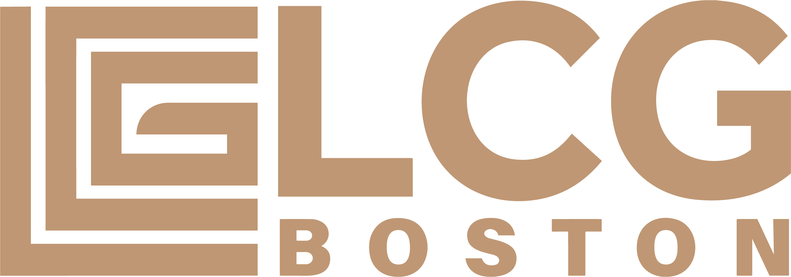
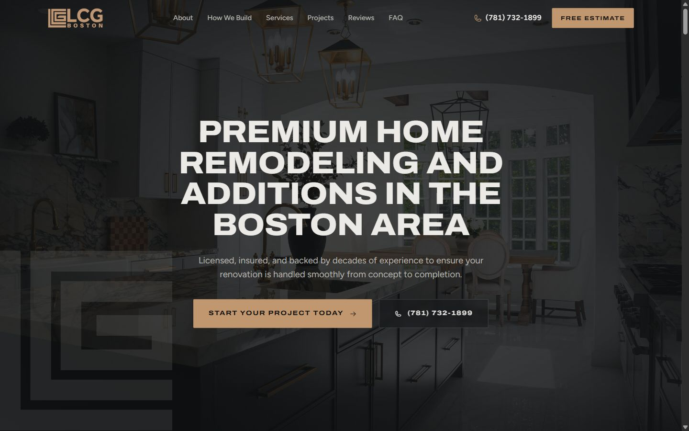
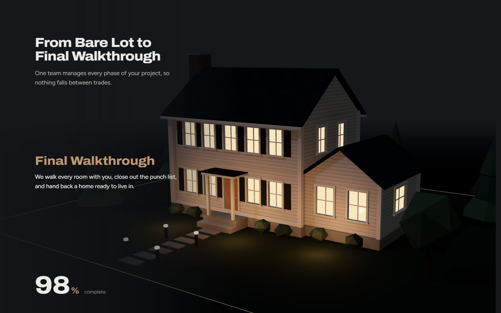
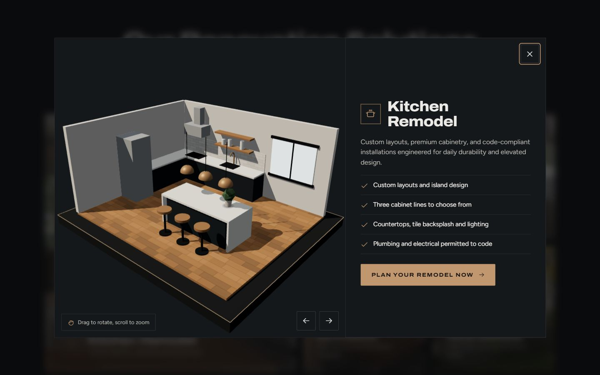

<div align="center">



<h3>Site institucional one page · LCG Boston LLC</h3>

<p>Premium Home Remodeling and Additions in the Boston Area</p>

<p>
  
  
  
  
  
  
</p>

<p>
  <a href="https://lcg.escolats.com.br"><b>Ambiente de teste</b></a>
  ·
  <a href="#rodar-localmente">Rodar localmente</a>
  ·
  <a href="#deploy">Deploy</a>
</p>

</div>

<br>



## Sobre

One page de alta conversão para a **LCG Boston LLC**, general contractor licenciada e segurada que atende a Grande Boston e o leste de Massachusetts com reformas de cozinhas e banheiros, reformas completas, ampliações, ADUs e exteriores.

O site foi pensado para o público americano de projetos de alto valor: transmite **solidez, ofício e confiança**, mostra o processo de obra de forma visual e leva o visitante até um formulário de orçamento em etapas.

## Destaques

<table>
  <tr>
    <td width="50%" valign="top">
      
      <h4>Casa 3D construída pelo scroll</h4>
      <p>A seção <i>How We Build</i> fica fixa enquanto uma casa colonial de New England é montada em Three.js, peça por peça: gabarito do terreno, fundação, estrutura de madeira, paredes, telhado, acabamentos e, no fim, o entardecer com as janelas acesas. Tudo procedural, sem modelos externos.</p>
    </td>
    <td width="50%" valign="top">
      
      <h4>Um modelo 3D por serviço</h4>
      <p>Os serviços são cards com foto e glassmorphism. Cada um abre um popup com um modelo 3D interativo (cozinha, banheiro, reforma completa, ampliação, ADU e telhado em camadas) e um botão que leva ao formulário já com o serviço selecionado.</p>
    </td>
  </tr>
</table>

**E também**

- **Formulário em 3 etapas** (projeto, detalhes, contato) com validação por etapa e escolha de serviço em um clique
- **Galeria em loop** com duas fileiras em direções opostas e fotos reais de obras
- **Identidade da marca em tudo:** paleta grafite e bronze, cantos retos e o monograma da logo usado como marca d'água
- **Responsivo de 320 px a monitores grandes**, com barra fixa de Call / Text / Free Estimate no celular
- **Acessível e leve:** `prefers-reduced-motion`, foco visível, renderização 3D sob demanda e fallback sem WebGL

## Stack

| Camada | Tecnologia |
|---|---|
| Base | HTML, CSS e JavaScript puros (ES modules), sem etapa de build |
| 3D | [Three.js 0.160](https://threejs.org) + OrbitControls |
| Movimento | [GSAP 3.12](https://gsap.com) + ScrollTrigger, [Lenis 1.1](https://lenis.darkroom.engineering) |
| Tipografia | Archivo (títulos, eixo de largura) e Figtree (texto), via Google Fonts |
| Ícones | [Phosphor Icons](https://phosphoricons.com) |
| Servidor | Apache com `.htaccess` (HTTPS, cache, compressão e cabeçalhos de segurança) |

As bibliotecas carregam por CDN com versão fixa, então não há `node_modules` nem dependências para instalar.

## Estrutura

```
.
├── index.html              # one page
├── privacy-policy.html     # /privacy-policy
├── terms-of-use.html       # /terms-of-use
├── clear-cache.html        # /clear-cache: limpa o cache do site no navegador
├── redirect.html           # /redirect: cartão de visita (ligar, texto, e-mail, site, orçamento)
├── lcg-boston.vcf          # contato para salvar no celular, baixado pelo cartão
├── 404.html                # página de erro no estilo do site
├── .htaccess               # HTTPS, URLs sem .html, cache, segurança, regras do ambiente de teste
├── robots.txt              # produção (libera tudo + sitemap)
├── robots-staging.txt      # servido no lugar do robots.txt em lcg.escolats.com.br
├── sitemap.xml             # as 3 páginas públicas
├── site.webmanifest        # nome, cores e ícones do site
├── favicon.ico             # 16, 32 e 48 px
├── humans.txt / llms.txt   # créditos e resumo para IAs
├── assets/
│   ├── css/style.css       # design system, todas as seções e páginas legais
│   ├── js/main.js          # interações, scroll, formulário e popup
│   ├── js/antispam.js      # armadilhas, tempo mínimo, sem links, limite por hora
│   ├── js/build3d.js       # casa 3D da seção How We Build
│   ├── js/service3d.js     # modelos 3D dos serviços
│   └── img/
│       ├── brand/          # logos e ícone
│       ├── icons/          # favicons, apple-touch-icon e ícones do manifest
│       ├── curated/        # fotos reais dos projetos
│       └── services/       # imagens dos cards de serviço
└── docs/screenshots/       # imagens deste README
```

## Rodar localmente

O site usa ES modules, então precisa de um servidor local (abrir o `index.html` direto no navegador não funciona).

```bash
# opção 1
npx serve .

# opção 2
python -m http.server 5391
```

Depois é só abrir `http://localhost:3000` (opção 1) ou `http://localhost:5391` (opção 2).

## Deploy

Produção: **[lcgbostonllc.com](https://lcgbostonllc.com)** · Teste: **[lcg.escolats.com.br](https://lcg.escolats.com.br)**

O mesmo `.htaccess` serve os dois: no domínio de teste ele manda `X-Robots-Tag: noindex` e entrega o `robots-staging.txt`; no domínio real ativa o HSTS de 1 ano. Nada para trocar entre um e outro.

1. Envie para a raiz: os 5 `.html`, `.htaccess`, `robots.txt`, `robots-staging.txt`, `sitemap.xml`, `site.webmanifest`, `favicon.ico`, `humans.txt`, `llms.txt` e a pasta `assets/`.
2. Confirme que o SSL está ativo (o `.htaccess` força HTTPS e manda `www.` para o domínio sem www).
3. Teste:
   - [ ] `/privacy-policy`, `/terms-of-use` e `/clear-cache` abrem sem `.html`
   - [ ] `/privacy-policy.html` redireciona (301) para `/privacy-policy`
   - [ ] `/qualquer-coisa` e `/404` mostram a página 404 com status 404
   - [ ] `/README.md` e `/.git/` devolvem 404
4. Cadastre o domínio no Google Search Console e envie o `sitemap.xml`.

**URLs:** nenhuma página usa `.html` no endereço. Links internos sempre no formato `/privacy-policy`, nunca `privacy-policy.html`.

**Cache:** ao alterar CSS ou JS, mude o `?v=` nos links do `index.html` e das páginas legais. Se um cliente ainda vir a versão antiga, mande o link `https://lcgbostonllc.com/clear-cache`.

### Pendências

- [x] Formulário `form01` ligado ao Web3Forms (`access_key` no `index.html`) com cópia de cada lead para o webhook da plataforma (`data-lead-webhook`, envio em `main.js`). Campos: `service`, `zip`, `timeline`, `details`, `name`, `phone`, `email`, `contact`
- [ ] Ativar o filtro de spam no painel do Web3Forms e conferir o e-mail de destino
- [ ] Enviar um pedido de teste no domínio final e confirmar que chega no e-mail e na plataforma de leads
- [ ] Trocar os depoimentos de exemplo por avaliações reais do Google
- [ ] Incluir número de licença (HIC / CSL) e endereço no rodapé e na seção "Contact us" das páginas legais
- [ ] Ao instalar Google Tag Manager / Analytics / Meta Pixel, revisar a seção "Cookies, analytics and ads" da Privacy Policy
- [ ] Se o site antigo do domínio tinha outras URLs indexadas, criar redirects 301 para elas no `.htaccess`

<br>

<div align="center">
  <sub>Desenvolvido por <a href="https://eusouts.com.br/"><b>Eu Sou TS</b></a></sub>
</div>
